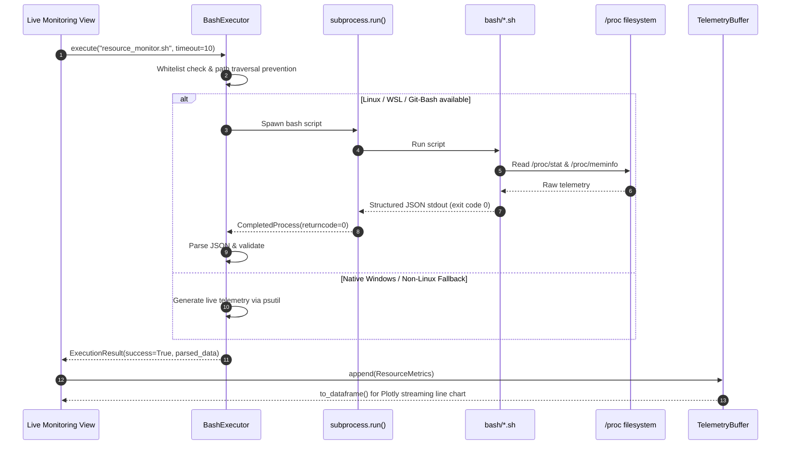
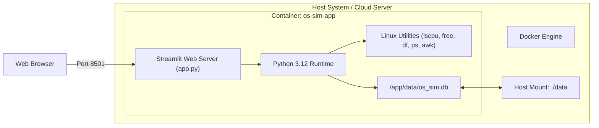

# OS-SIM System Architecture Documentation

Welcome to the **OS-SIM** technical architecture guide. This document details the software architecture, modular components, algorithmic foundations, telemetry dataflow, and deployment topology.

---

## 1. High-Level Architectural Blueprint

OS-SIM uses a decoupled, modular design divided into three primary tiers:

```mermaid
flowchart TD
    subgraph Client ["Client Tier (Browser)"]
        Browser["User Browser (Port 8501)"]
    end

    subgraph Presentation ["Presentation & Dashboard Tier (Streamlit)"]
        App["app.py (Navigation & Entry)"]
        CPUView["dashboard/cpu_view.py"]
        MemView["dashboard/memory_view.py"]
        PageView["dashboard/paging_view.py"]
        DiskView["dashboard/disk_view.py"]
        DeadlockView["dashboard/deadlock_view.py"]
        LiveView["dashboard/system_view.py"]
        HistoryView["dashboard/history_view.py"]
        GanttComp["dashboard/components/gantt.py"]
    end

    subgraph Logic ["Simulation & Algorithmic Engines"]
        CPUSched["algorithms/cpu/ (FCFS, SJF, SRTF, RR, Priority, MLFQ)"]
        MemAlloc["algorithms/memory/ (First, Best, Worst, Next Fit)"]
        PageRepl["algorithms/paging/ (FIFO, LRU, Optimal, Clock)"]
        DiskSched["algorithms/disk/ (FCFS, SSTF, SCAN, C-SCAN, LOOK, C-LOOK)"]
        DeadlockMgmt["algorithms/deadlock/ (Banker's Avoidance, WFG Detection)"]
    end

    subgraph Telemetry ["Linux Telemetry & Integration Tier"]
        BashExec["core/executor.py (BashExecutor)"]
        BashScripts["bash/*.sh (system_info, resource, disk, process, health)"]
        PydanticModels["core/models.py (Pydantic Schemas)"]
        CircBuffer["core/buffer.py (TelemetryBuffer)"]
    end

    subgraph Storage ["Persistence & Analytics Tier"]
        DBManager["database/db_manager.py (SQLite)"]
        ExportUtil["analytics/export.py (CSV & JSON)"]
        DBFile["data/os_sim.db"]
    end

    Browser <--> Presentation
    App --> CPUView & MemView & PageView & DiskView & DeadlockView & LiveView & HistoryView
    CPUView --> CPUSched & GanttComp
    MemView --> MemAlloc
    PageView --> PageRepl
    DiskView --> DiskSched
    DeadlockView --> DeadlockMgmt
    LiveView --> BashExec --> BashScripts
    BashExec --> PydanticModels --> CircBuffer
    HistoryView --> DBManager --> DBFile
    HistoryView --> ExportUtil
```

---

## 2. Linux Telemetry & Subprocess Dataflow

The host monitoring subsystem provides non-destructive telemetry with strict security sandboxing:

---

## 3. Algorithmic Modules

### CPU Scheduling Engine
- **Process State Machine**: Supports arrival queues, preemption slices, and completion bookkeeping.
- **Algorithms**: FCFS, SJF (Non-preemptive), SRTF (Preemptive), Round Robin ($q$), Priority (Preemptive & Non-preemptive), and 3-queue MLFQ with anti-starvation aging.

### Contiguous Memory Allocation Engine
- **Variable Partitioning**: Dynamic allocation supporting First Fit, Best Fit, Worst Fit, and Next Fit.
- **Adjacent Coalescing**: Automatically combines free memory partitions on deallocation.
- **Dynamic Compaction**: Consolidates fragmented holes into one contiguous high-address block.

### Virtual Memory & Page Replacement
- **Frame Matrices**: Traces exact physical frame states across each step of the reference string.
- **Algorithms**: FIFO, LRU, Optimal (forward lookahead), and Clock (second-chance reference bits).
- **Belady's Anomaly Detection**: Automated frame-scaling analysis.

### Disk Scheduling Engine
- **Traversals**: FCFS, SSTF, SCAN, C-SCAN, LOOK, and C-LOOK with customizable boundary limits and directional sweeps.

### Deadlock Management Engine
- **Deadlock Avoidance**: Dijkstra's Banker's Algorithm with multiple resource instances, Need matrix evaluation ($Need = Max - Allocation$), safety verification, and interactive dynamic resource-request safety checks.
- **Deadlock Detection**: Multi-instance matrix reduction algorithm and Wait-For Graph (WFG) directed cycle detection.

---

## 4. Deployment Topology

